  

<h3 align="center">Sobre Mim</h3>

Sou estudante de Desenvolvimento de Software Multiplataforma na Fatec Jacareí, atualmente em busca de obter conhecimento profissional e oportunidades de vagas. Estou sempre querendo aprender mais sobre desenvolvimento full-stack e gosto de transformar ideias em realidade. Em paralelo, estudo cibersegurança: quero entender como as aplicações quebram para aprender a construí-las melhor.

 

<h3 align="center">Tecnologias e ferramentas</h3>

  
<i>Algumas das tecnologias e ferramentas que utilizo no dia a dia para criar e explorar projetos:</i>

   
  

   

<h3 align="center">Estatísticas</h3>

<table>
  <tr>
    <td align="center" valign="top" width="50%">
      
       
      
    <td align="center" valign="middle" width="50%">
      
       
      
    </td>
  </tr>
</table>

 

<code>// fim do perfil · última atualização [11/2026]</code>

