  

<h3 align="center">Sobre Mim</h3>

Meu nome é Vinicius Guin, sou um desenvolvedor, que adora tecnologia, desenvolvimento criativo e lógico. Estou construindo minha base em desenvolvimento full-stack e gosto de transformar ideias em realidade. Em paralelo, estudo cibersegurança: quero entender como as aplicações quebram para aprender a construí-las melhor.

Meu primeiro projeto foi desenvolvido durante uma aula de programação na escola, depois disso fui aprendendo mais sobre as áreas da tecnologia, me interessei por full-stack, cibersegurança e estou sempre obtendo mais conhecimento todo dia

 

<h3 align="center">Tecnologias e ferramentas</h3>

  
<i>Algumas das tecnologias e ferramentas que utilizo no dia a dia para criar e explorar projetos:</i>

   
  

   

<h3 align="center">Estatísticas</h3>

<table>
  <tr>
    <td align="center" valign="top" width="50%">
      
       
      
       
      <a>
        desafio oculto · abra uma issue com o título "flag" se decifrar
        <code>U1lOVHtpYnByX3lyaF9iX3BicXZ0Yl9zYmFncn0=</code>
      </a>
    <td align="center" valign="middle" width="50%">
      
       
      
    </td>
  </tr>
</table>

 

<code>// fim do perfil · última atualização [10/2026]</code>

